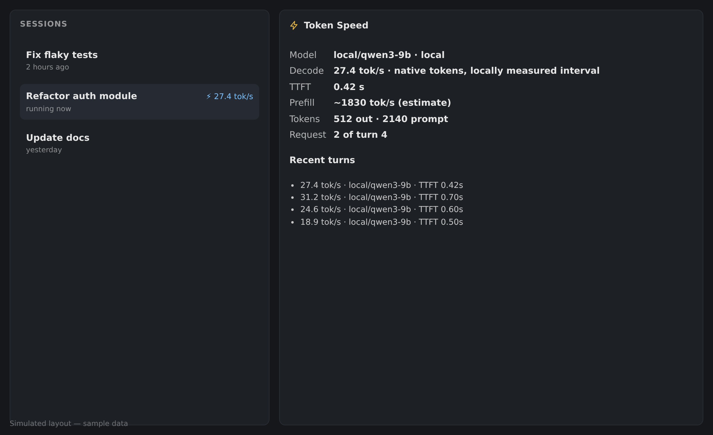

# pi-web-token-speed

Generation speed (tokens/second) for your LLMs, right inside the **Pi Web** chat UI.

This is a Pi Web plugin, not a terminal feature: it shows up in the browser, next to your
sessions. The TUI keeps its own footer indicator and is not touched.



## What you get

- **On the session row**: `⚡ 27.4 tok/s` while a model answers, `≈ 24.1 tok/s` (estimate) while
  streaming, `N/A` when it can't be measured.
- **In a "Token Speed" side panel**: decode rate, TTFT, prefill estimate, token counts, and the
  last few turns.

## How it works

Two pieces, no backend changes:

| piece | what it does |
| --- | --- |
| Pi extension | measures with native Pi hooks (`before_provider_request`, `message_update`, `message_end`) and publishes numbers on the session event bus |
| Pi Web plugin | relays them to the browser and renders the label and the panel |

The extension stays silent unless the web plugin is actually connected, so overhead is near zero
when you're not using it.

| number | how it's computed | nature |
| --- | --- | --- |
| decode tok/s | `usage.output / (request end − first delta)` | measured (native tokens, locally measured interval) |
| TTFT | first delta − request start | measured (includes network and server queue) |
| prefill tok/s | prompt tokens / TTFT | estimate, marked `~` |
| live rate | 3 s rolling window over streamed characters × learned tok/char ratio | estimate, marked `≈` |

Native token counts only arrive when a request finishes, which is why the in-progress number is a
labelled estimate and never passed off as a measurement. Tool execution time is excluded by design.

## Install

```sh
npm i pi-web-token-speed
```

or clone the repo. Below, `<pkg>` is the package folder: `node_modules/pi-web-token-speed` after the
npm install, or your clone. The link names stay `pi-token-speed`: that is the internal plugin id, not
the package name.

**1. Pi extension (measures).** Link the *folder*, not the single file:

```sh
ln -s <pkg> ~/.pi/agent/extensions/pi-token-speed
```

Then `/reload` in running sessions.

**2. Pi Web plugin (displays).**

```sh
mkdir -p ~/.pi-web/plugins
ln -s <pkg> ~/.pi-web/plugins/pi-token-speed
systemctl --user restart pi-web-sessiond
```

Reload the browser tab; enable it under **Settings → PI WEB plugins** if it isn't.

> Restarting the session daemon interrupts active sessions and terminals. Do it when nothing is
> running.

Uninstall: remove the two symlinks and restart the daemon again.

## Notes and limits

- The final rate uses native tokens but a locally measured interval, so it includes network and
  server queue — it is not the backend's internal decode time.
- The live rate stays an estimate until backends expose per-chunk usage.
- The live estimate calibrates from plain answers; in a tool-heavy session it keeps the default
  ratio.
- Values are ephemeral by design: nothing is written to transcripts or session files.

## Development

```sh
npm test          # engine, protocol, extension, server, browser, installed APIs, reliability
npm run check     # syntax check
PTS_CDP_URL=http://localhost:9223 npm run screenshot   # regenerate docs/screenshot.png
```

The screenshot is rendered from a simulated layout with sample data — no transcripts, no hostnames.

## License

MIT
